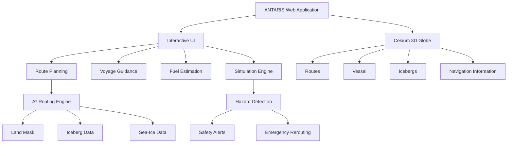
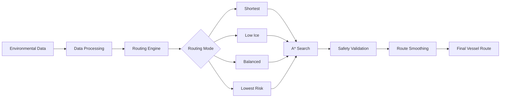
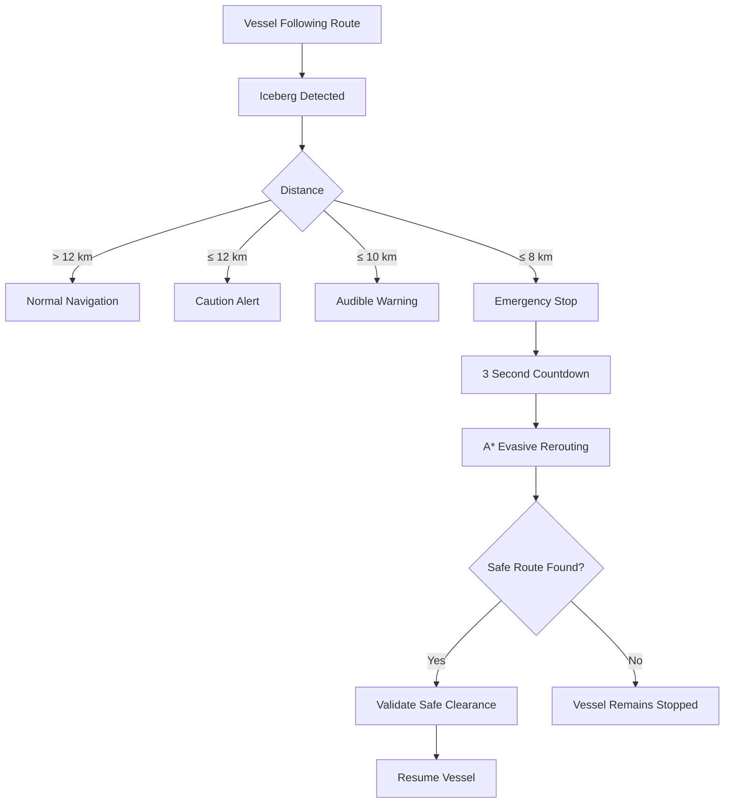
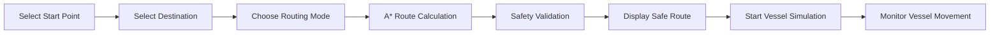

# ANTARIS

### Antarctic Maritime Navigation & Decision Support System

ANTARIS is an interactive maritime navigation decision-support system designed for safer and more efficient vessel routing in Antarctic waters.

It combines **A* route planning, iceberg avoidance, sea-ice awareness, fuel estimation, voyage guidance, and 3D Cesium visualization** in a single interactive platform.

---

## 🚀 Key Features

-  **A* Route Planning** for safe vessel navigation
-  **Iceberg Detection & Avoidance**
-  **Sea-Ice Awareness** for route planning
-  **Fuel Consumption Estimation**
-  **Voyage Guidance** with heading, bearing, ETA and cross-track information
-  **3D Antarctic Visualization** using Cesium
-  **Vessel Movement Simulation**
-  **Automatic Hazard Detection & Rerouting**
-  Multiple routing modes: shortest, low-ice, balanced and lowest-risk

---

## 🧩 System Architecture



---

## 🔄 Data & Routing Flow



---

## 🧊 Hazard Response Flow



---

## 🚢 Simulation 1: Route Planning

Simulation 1 demonstrates normal vessel route planning from a selected starting point to a destination.

### Simulation Flow



### Controls

- **START** - Begin vessel movement
- **PAUSE** - Pause the simulation
- **RESUME** - Continue vessel movement
- **RESET** - Reset the simulation
- **1x / 2x / 5x / 10x** - Control simulation speed

The route can also be recalculated when the destination changes.

---

##  Simulation 2: Automatic Hazard Response

Simulation 2 demonstrates how ANTARIS responds to an approaching grounded iceberg.

### Example Hazard

**Grounded Iceberg #620**

- Latitude: `-65.7160°`
- Longitude: `135.8324°`
- Area: `0.62 km²`
- Bed depth: `-450 m`

### Response Sequence

| Distance | System Response |
|---|---|
| 12 km | Caution warning |
| 10 km | Audible warning |
| 8 km | Vessel emergency halt |
| 3-second countdown | Prepare evasive route |
| After rerouting | Validate safe clearance |
| Safe route found | Vessel resumes navigation |
| No safe route | Vessel remains stopped |

The system maintains a hard safety clearance around the hazard and generates an alternative A* route when possible.

> Simulation 2 provides simulated tactical steering recommendations and is not connected to physical ship-control hardware.

---

## 🗺️ Routing Modes

ANTARIS supports multiple routing strategies:

| Mode | Description |
|---|---|
| **Shortest** | Prioritizes route distance |
| **Low Ice** | Prioritizes areas with lower sea-ice conditions |
| **Balanced** | Balances route distance and environmental conditions |
| **Lowest Risk** | Prioritizes safer routing conditions |

The routing engine uses A* search with environmental and geographic constraints.

---

## ⛽ Fuel Estimation

ANTARIS includes a hydrodynamic-style fuel estimation model using:

- Vessel speed
- Propulsion power
- Specific fuel consumption
- Auxiliary fuel consumption
- Sea-ice penalty
- Fuel density
- Voyage distance

### Example Vessel Profiles

- Polar Icebreaker
- Supply Vessel
- Cargo Ship

Fuel outputs are marked as **estimated values** and should not be treated as operational fuel guarantees.

---

## 🧭 Voyage Guidance

ANTARIS provides navigation information including:

- Current vessel position
- Bearing to waypoint
- Heading
- Heading error
- Cross-track error
- ETA
- Compass direction

---

##  Download & Installation

### 1. Clone the repository

```bash
git clone https://github.com/eprem02/ANTARIS.git
cd ANTARIS
```

### 2. Install dependencies

```bash
npm install
```

### 3. Start the application

```bash
npm run dev
```

The terminal will display the local development URL.

Open that URL in your browser.

---

## How to Use

1. Open ANTARIS in your browser.
2. View the Antarctic environment on the 3D globe.
3. Select the vessel's starting location.
4. Select the destination.
5. Choose a routing mode.
6. Generate the route.
7. Start the vessel simulation.
8. Monitor navigation and environmental information.
9. Test hazard response using Simulation 2.
10. Observe automatic warnings, vessel stopping and evasive rerouting.

---

## 🧱 Technology Stack

| Component | Technology |
|---|---|
| Frontend | React |
| Build Tool | Vite |
| 3D Visualization | Cesium |
| Routing | A* Search |
| Mapping | Geospatial datasets |
| Environmental Data | Iceberg & Sea-Ice datasets |
| Development | JavaScript / TypeScript ecosystem |

---

## 📁 Project Structure

```text
ANTARIS/
├── src/
│   ├── components/
│   ├── data/
│   ├── routing/
│   ├── simulation/
│   └── ...
├── public/
├── data/
├── Antarctic-Grounded-Iceberg-Detection/
├── README.md
├── package.json
├── vite.config.js
└── .gitignore
```

Large datasets and model files are excluded from Git where appropriate.

---

## 🌍 Data Sources

ANTARIS uses locally available environmental and geospatial data for its simulations and route planning, including:

- Grounded iceberg data
- Antarctic sea-ice data
- Geographic land-mask information
- Vessel and environmental parameters

The application is designed to work with the project's available datasets and configured services.

---

## ⚠️ Limitations

ANTARIS is a **decision-support and simulation platform**.

It should not be treated as:

- A certified navigation system
- A replacement for professional maritime decision-making
- A real-time operational forecasting service
- An autonomous ship-control system
- A substitute for official nautical charts, weather information or maritime regulations

Environmental conditions in Antarctic waters can change rapidly. Operational navigation should always use appropriate certified systems and current authoritative data.

---


## 👥 Team

**ANTARIS** is developed as a maritime navigation and decision-support project focused on Antarctic operations.

---

## 📄 License

This project is licensed under the **MIT License**.

---

## ⭐ ANTARIS

**Interactive Antarctic Maritime Navigation & Decision Support**

> Plan safer routes. Understand environmental risks. Navigate smarter.

